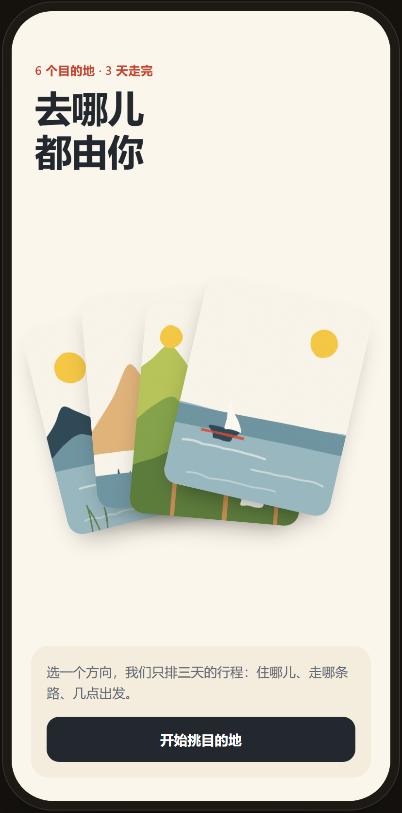
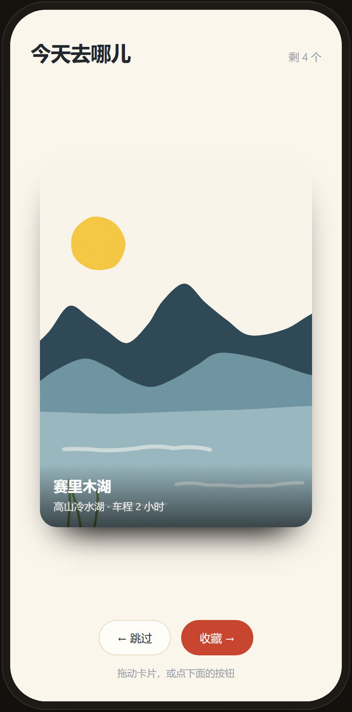
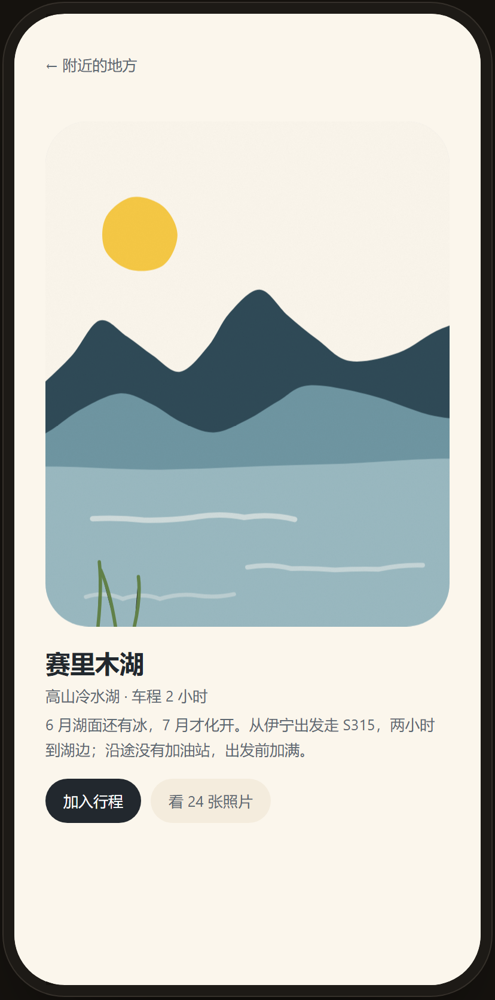
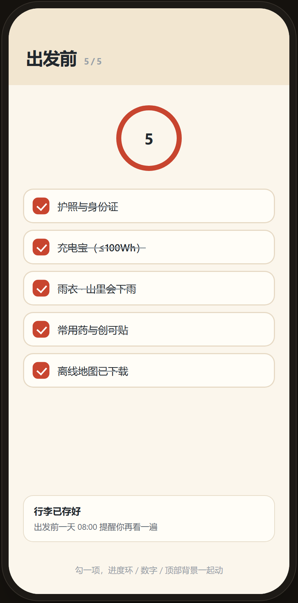

# App Interaction Motion

19 个 App / 小程序交互动效模式，配一个真实的弹簧物理引擎和一套真浏览器验收脚本。
不是效果清单——是「让每一次触碰都有清楚回应」的具体做法。

**在线体验：<https://jellyfishhamburger.github.io/app-interaction-motion/>**
（手机打开最好，9 个场景可以逐个点）

## 里面有什么

| 路径 | 内容 |
|---|---|
| `SKILL.md` | 给 AI 用的技能说明：5 条核心规则、19 个模式索引、构建流程、踩过的坑 |
| `references/patterns.md` | 19 个模式的触发 / 机制 / 参数 / 代码 / 坑 |
| `references/gesture-physics.md` | 阻尼振子、二维弹簧、指针速度、橡皮筋、抛掷落点预测、实测手感参数表 |
| `references/craft-and-look.md` | 配色、手绘水粉插画画法（无描边 + 手切边 + 印刷颗粒）、版面密度、排版 |
| `demo/` | 9 个可跑场景：开场落下收拢 / 扇形叠 / 滑动分拣 / 共享元素 / 可收面板 / 逐行标题 / 惯性滚轮 / 完成反馈 / 联动勾选 |
| `demo/verify.mjs` | 24 条断言：真指针拖动、25ms 逐帧采样弹簧、390px 溢出、reduced-motion |

## 截图

| 开场落下收拢 | 滑动分拣 | 共享元素 | 联动勾选 |
|---|---|---|---|
|  |  |  |  |

## 9 个场景

1. **开场落下收拢** — 照片依次落下堆叠 → 弹簧收成扇形 → 其余飞出 → 标题升起
2. **扇形叠切换** — 左右滑动，整组按索引重排位，标题与指示点跟随
3. **滑动分拣** — 跟手平移，过阈值飞出，下一张从缩小压暗弹回
4. **共享元素** — 4:5 缩略图位移 + 等比放大，操作按钮延迟 0.18 秒
5. **可收面板** — 面板下滑淡出，地图放大填满，圆角按钮原路回升
6. **逐行标题** — 旧标题逐行下落 60ms，新标题逐行上升，主视觉弹回
7. **惯性滚轮** — 甩动带惯性减速，吸附刻度，越界橡皮筋
8. **完成反馈** — 药丸 clip-path 收成圆 → 一笔画勾 → 粒子 → 变「已加入」
9. **联动勾选** — 一个勾选同时驱动进度环、数字滚动、顶部背景

## 跑起来

```bash
node demo/serve.mjs        # 打印 localhost 和手机可用的局域网地址
node demo/verify.mjs       # 需要本机装了 Chrome；截图写到 demo/.verify/
```

## 装成技能

```bash
git clone https://github.com/jellyfishhamburger/app-interaction-motion.git \
  ~/AppData/Local/hermes/skills/creative/app-interaction-motion
```

## 出处

- 19 个模式来自 Leiman 收集并整理的三组交互动效提示词（旅行 App 六细节 / 七个转场 / 六个微交互）。
- 手绘水粉画法参考 [fred.pt](https://fred.pt) 的插画语言。
- 弹簧解法与手感参数在同名技能 `web-motion-design` 的 `references/spring-motion.md` 基础上的二维与手势扩展。

MIT.
